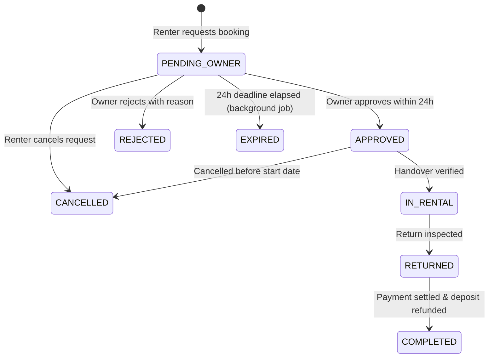

# AgriRent — Microservices Architecture & System Design

## 1. Executive Overview

**AgriRent** is a peer-to-peer agricultural equipment rental marketplace connecting farmers who own idle agricultural machinery (tractors, harvesters, rotavators, seed drills, etc.) with farmers needing temporary equipment access.

This implementation focuses on the two core operational pillars:
1. **Equipment Management Service** (Service A, default port `4001`)
2. **Booking Management Service** (Service B, default port `4002`)

The platform adheres strictly to **Service-Oriented Architecture (SOA)** and **Microservices Design Principles**:
- **Independent Database per Service:** Neither service shares a database or imports the other's models, schemas, or internal files.
- **RESTful Inter-Service Communication:** Services communicate over HTTP using versioned JSON REST APIs with explicit timeouts, bounded retries, and correlation ID tracking.
- **Strict Single Source of Truth:**
  - Equipment Service is the sole authority on equipment metadata, pricing configurations, and listing states.
  - Booking Service is the sole authority on booking lifecycles, date reservations, price snapshots, and availability calculations.
- **Resilience & Fault Isolation:** Failures in external integrations (e.g., Booking Service down when listing equipment) do not cascade destructively; fallback behaviors and standard HTTP error codes (`503 DEPENDENCY_UNAVAILABLE`, `503 EQUIPMENT_SERVICE_UNAVAILABLE`) are clearly established.

---

## 2. Service Responsibilities & Boundaries

```
+-------------------------------------------------------------+
|                      API Gateway / Client                   |
+-------------------------------------------------------------+
               |                               |
       (JWT / Auth Header)             (JWT / Auth Header)
               |                               |
               v                               v
+-------------------------------+   HTTP REST   +-------------------------------+
|  Equipment Management Service | <-----------> |   Booking Management Service  |
|         (Port: 4001)          |   Contracts   |          (Port: 4002)         |
+-------------------------------+               +-------------------------------+
               |                                               |
        (Mongoose ODM)                                  (Mongoose ODM)
               v                                               v
+-------------------------------+               +-------------------------------+
|     agrirent_equipment        |               |       agrirent_bookings       |
|       (MongoDB DB)            |               |         (MongoDB DB)          |
+-------------------------------+               +-------------------------------+
```

### 2.1 Equipment Management Service
- **Core Domain:** Equipment catalog, machine specifications, pricing, security deposits, physical pickup locations, and operational states (`DRAFT`, `ACTIVE`, `INACTIVE`, `MAINTENANCE`).
- **Authorization Boundary:** Only verified machine owners can create, modify, or deactivate equipment.
- **Deactivation Safety Contract:** Before deactivating or soft-deleting an equipment listing, the service queries the Booking Service to verify that no active (`PENDING_OWNER`, `APPROVED`, `IN_RENTAL`) bookings exist.
- **Availability Query Proxy:** Provides read-only availability queries by delegating authoritative availability calculations to the Booking Service.

### 2.2 Booking Management Service
- **Core Domain:** Rental booking requests, pricing snapshot calculation, concurrency-safe reservation, owner approvals/rejections, 24-hour request expiry, cancellations, and booking state transitions.
- **External Dependency:** Queries the Equipment Service via `equipment.client.js` to retrieve live listing metadata, confirm active status, and capture immutable pricing snapshots.
- **Authoritative Date Reservation:** Evaluates half-open date interval overlaps `[startDate, endDate)` to guarantee no two overlapping bookings reserve the same equipment.

---

## 3. Date Convention & Concurrency-Safe Overlap Prevention

### 3.1 Half-Open Date Interval Convention: `[startDate, endDate)`
AgriRent treats the booking `startDate` as **inclusive** (pickup day) and the `endDate` as **exclusive** (return day).
- **Duration Formula:**
  $$\text{rentalDays} = \lceil (\text{endDate} - \text{startDate}) / (1000 \times 60 \times 60 \times 24) \rceil$$
- **Example:**
  - Start Date: `2026-11-01`
  - End Date: `2026-11-03`
  - Duration: Exactly 2 rental days (Nov 1 and Nov 2; equipment returned on Nov 3).

### 3.2 Overlap Condition
Two booking intervals $[S_1, E_1)$ and $[S_2, E_2)$ conflict if and only if:
$$\text{existing.startDate} < \text{requested.endDate} \quad \text{AND} \quad \text{existing.endDate} > \text{requested.startDate}$$

#### Valid Non-Conflicting Adjacent Bookings:
- Booking A: Nov 1 to Nov 3 $[2026-11-01, 2026-11-03)$
- Booking B: Nov 3 to Nov 5 $[2026-11-03, 2026-11-05)$
- *Result:* No conflict! Equipment is returned on the morning of Nov 3 and picked up for Booking B on Nov 3.

#### Conflicting Overlapping Bookings:
- Booking A: Nov 1 to Nov 3 $[2026-11-01, 2026-11-03)$
- Booking B: Nov 2 to Nov 4 $[2026-11-02, 2026-11-04)$
- *Result:* **409 DATE_CONFLICT** rejected immediately.

### 3.3 Active Reserving States
Dates are reserved only by bookings in the following states:
1. `PENDING_OWNER` (held during the 24-hour decision window)
2. `APPROVED` (confirmed by owner)
3. `IN_RENTAL` (actively in progress)

Terminal or non-reserving states (`REJECTED`, `EXPIRED`, `CANCELLED`, `RETURNED`, `COMPLETED`) release all reservations immediately.

### 3.4 Concurrency-Safe Reservation Strategy
In high-concurrency environments, a simple query (`findOne`) followed by insertion (`create`) suffers from race conditions where two simultaneous requests could both observe zero conflicts and proceed to create conflicting records.

AgriRent implements an **atomic equipment reservation mutex**:
1. An atomic lock document in MongoDB (`ReservationLock`) is acquired for the specific `equipmentId` using `findOneAndUpdate({ equipmentId, locked: false }, { locked: true, lockedAt: new Date() })` with atomic lease timeout (e.g., 5 seconds).
2. While holding the lock, the service queries existing active bookings for interval overlaps.
3. If no conflict exists, the new `Booking` document is inserted and the lock is released in a guaranteed `finally` block.
4. If a conflict exists, the request is rejected with `409 DATE_CONFLICT` and the lock is released.
5. In MongoDB Replica Set environments, this is additionally backed by multi-document ACID transactions with `ReadPreference: primary` and `WriteConcern: majority`.

---

## 4. Server-Side Financial Calculations

Clients must never supply pricing totals. All monetary values are computed authoritatively on the server from the equipment snapshot:
- $\text{pricePerDaySnapshot} = \text{equipment.pricePerDay}$
- $\text{rentalAmount} = \text{rentalDays} \times \text{pricePerDaySnapshot}$
- $\text{platformFee} = \text{Math.round}(\text{rentalAmount} \times 0.03 \times 100) / 100$ (3% marketplace fee)
- $\text{securityDeposit} = \text{equipment.securityDeposit}$
- $\text{totalAmount} = \text{rentalAmount} + \text{platformFee} + \text{securityDeposit}$
- All amounts are denominated in `INR` (₹).

---

## 5. Booking Lifecycle & 24-Hour Expiry Engine



### 5.1 24-Hour Expiry Mechanism
1. When a booking is created, `ownerResponseDeadline` is set to `Date.now() + 24 * 60 * 60 * 1000`.
2. A background worker (`expireBookings.job.js`) runs periodically (configured via `node-cron`, e.g., every 5 minutes).
3. The job atomically queries:
   ```javascript
   {
     status: 'PENDING_OWNER',
     ownerResponseDeadline: { $lte: new Date() }
   }
   ```
4. Each matching booking is atomically transitioned to `EXPIRED`, recording `expiredAt = new Date()` and logging structured audit events.
5. **Defense in Depth:** The approval endpoint also checks `booking.ownerResponseDeadline <= new Date()` synchronously. If expired, approval is rejected with `409 BOOKING_EXPIRED`.

---

## 6. Authentication & KYC Verification Model

1. **JWT Verification:** Middleware validates JWT access tokens using `JWT_SECRET` or `JWT_PUBLIC_KEY`.
2. **Identity Derivation:** `req.user` contains `{ id, email, role, kycStatus }`.
   - `ownerId` for equipment listings is derived strictly from `req.user.id`.
   - `renterId` for booking requests is derived strictly from `req.user.id`.
3. **KYC Gate:**
   - Agricultural machinery represents high-value physical assets.
   - Users must possess `kycStatus: 'VERIFIED'` to publish listings or initiate rental requests.
   - If `kycStatus !== 'VERIFIED'`, the middleware returns `403 KYC_REQUIRED`.
4. **Development Testing Mode:**
   - In `development` mode, mock credentials or bypass headers (`x-user-id`, `x-kyc-status`, `x-user-role`) can be accepted for rapid testing if `MOCK_AUTH=true`. In `production`, this bypass is strictly disabled.

---

## 7. Distributed Tracing & Standard Error Format

Every request generates or propagates an `x-correlation-id` header:
- Equipment Client sends `x-correlation-id` to the Equipment Service.
- Error responses adhere to the standard JSON schema:

```json
{
  "error": {
    "code": "DATE_CONFLICT",
    "message": "Equipment is already reserved for the selected dates.",
    "correlationId": "req-123",
    "details": null
  }
}
```
