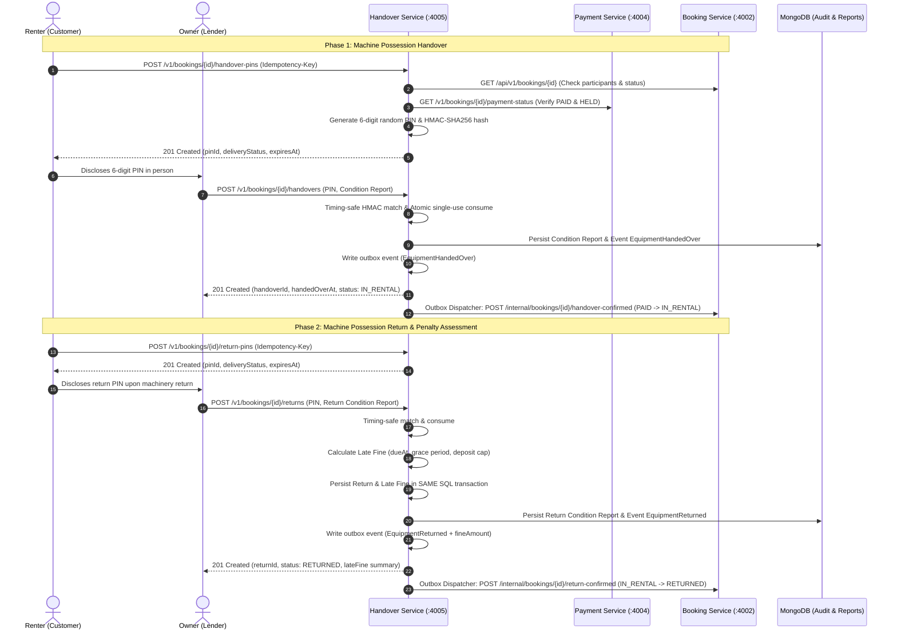

# AgriRent SOA Contract Sheet: Service 5 — Handover, Return & Late-Fine Service

## 1. Architectural Architecture & Sequence Flow



---

## 2. Formal Service Operation Contract Sheets

### Contract Sheet 1: GenerateHandoverPIN
- **Service Name**: Handover, Return & Late-Fine Service (Service 5)
- **Operation**: `GenerateHandoverPIN`
- **Endpoint**: `POST /v1/bookings/{bookingId}/handover-pins`
- **Authentication**: Bearer JWT (Renter role), Admin, or Internal Service Token (`internal_service_token`). KYC verified account required.
- **Headers**:
  - `Idempotency-Key`: Required string
  - `x-correlation-id`: Optional tracing UUID
- **Input Schema**:
  - Path: `bookingId` (string, required)
  - Body: `{}` (empty or optional configuration)
- **Output Schema (201 Created)**:
  ```json
  {
    "pinId": "PIN-9D82A1B4",
    "deliveryStatus": "DELIVERED",
    "expiresAt": "2026-10-25T10:30:00.000Z"
  }
  ```
  *(Note: Plaintext PIN is never returned in production responses or idempotency snapshots; it is dispatched exclusively through the notification channel).*
- **Errors**:
  - `400 INVALID_INPUT`: Schema failure.
  - `401 UNAUTHENTICATED`: Missing or expired Bearer token.
  - `403 UNAUTHORIZED_USER`: Caller is not the renter for this booking.
  - `403 KYC_REQUIRED`: Renter account has not completed KYC verification.
  - `404 BOOKING_NOT_FOUND`: Booking ID not found in Booking catalog.
  - `409 INVALID_BOOKING_STATE`: Booking status is not `PAID`.
  - `409 PAYMENT_NOT_CONFIRMED`: Payment status is not `CONFIRMED`.
  - `429 RATE_LIMIT_EXCEEDED`: Exceeded hourly generation cap (default 5/hr).
  - `503 UPSTREAM_UNAVAILABLE`: Booking or Payment service circuit breaker is open.
  - `504 UPSTREAM_TIMEOUT`: Outbound service call timed out after 5000ms.
- **Preconditions**: Booking must exist, be in `PAID` status, with confirmed payment and held deposit.
- **Postconditions**: Active PIN created in SQLite `pins` table. Any previous active handover PIN marked `SUPERSEDED`. Notification dispatched. `PinGenerated` event logged in MongoDB.
- **Dependencies**: Booking Service (`GET /api/v1/bookings/{id}`), Payment Service (`GET /v1/bookings/{id}/payment-status`).
- **Idempotency**: Replaying with same `Idempotency-Key` and identical body replays cached 201 response with `Idempotent-Replayed: true` (stripped of any plaintext PIN).

---

### Contract Sheet 2: VerifyHandoverPIN
- **Service Name**: Handover, Return & Late-Fine Service (Service 5)
- **Operation**: `VerifyHandoverPIN`
- **Endpoint**: `POST /v1/bookings/{bookingId}/handovers`
- **Authentication**: Bearer JWT (Owner role) or Internal Service Token. KYC verified account required.
- **Headers**:
  - `Idempotency-Key`: Required string
  - `x-correlation-id`: Optional tracing UUID
- **Input Schema**:
  ```json
  {
    "pin": "482910",
    "conditionReport": {
      "engineHours": 250.5,
      "fuelLevelPercent": 95,
      "cleanliness": "GOOD",
      "visualInspectionNotes": "Normal hitch wear.",
      "photoUrls": ["https://storage.agrirent.internal/ho/photo1.jpg"]
    }
  }
  ```
- **Output Schema (201 Created)**:
  ```json
  {
    "handoverId": "HO-4F12BC99",
    "handedOverAt": "2026-10-25T10:05:00.000Z",
    "status": "IN_RENTAL"
  }
  ```
- **Errors**:
  - `400 INVALID_INPUT`: Malformed payload or PIN not matching `^[0-9]{6}$`.
  - `401 UNAUTHENTICATED`: Missing or invalid Bearer token.
  - `403 UNAUTHORIZED_USER`: Caller is not the equipment owner.
  - `404 PIN_NOT_FOUND`: No active handover PIN exists for booking.
  - `409 INVALID_BOOKING_STATE`: Booking already handed over or not in `PAID` status.
  - `409 PAYMENT_NOT_CONFIRMED`: Payment not verified.
  - `409 PIN_ALREADY_USED`: PIN was previously consumed.
  - `409 PIN_EXPIRED`: PIN validity window has elapsed.
  - `422 INVALID_PIN`: Incorrect PIN digits. Attempt counter incremented.
  - `423 PIN_LOCKED`: PIN locked after 3 failed attempts.
  - `429 RATE_LIMIT_EXCEEDED`: Verification attempt limit exceeded on IP or booking window.
- **Preconditions**: Booking in `PAID` status; active PIN exists.
- **Postconditions**: Handover record written to `handovers`; PIN status marked `USED`; outbox event `EquipmentHandedOver` queued; condition report saved in MongoDB `handover_events`.
- **Dependencies**: Booking Service, Payment Service.
- **Idempotency**: Atomic SQL transaction with `Idempotency-Key` response replay.

---

### Contract Sheet 3: GenerateReturnPIN
- **Service Name**: Handover, Return & Late-Fine Service (Service 5)
- **Operation**: `GenerateReturnPIN`
- **Endpoint**: `POST /v1/bookings/{bookingId}/return-pins`
- **Authentication**: Bearer JWT (Renter role) or Internal Service Token.
- **Headers**: `Idempotency-Key`, `x-correlation-id`.
- **Input Schema**: Path: `bookingId`. Body: `{}`.
- **Output Schema (201 Created)**:
  ```json
  {
    "pinId": "PIN-B821CA00",
    "deliveryStatus": "DELIVERED",
    "expiresAt": "2026-10-28T18:30:00.000Z"
  }
  ```
- **Errors**:
  - `403 UNAUTHORIZED_USER`: Caller not renter.
  - `409 BOOKING_NOT_IN_RENTAL`: Booking status is not `IN_RENTAL`.
- **Preconditions**: Booking must be in `IN_RENTAL` status.
- **Postconditions**: Active return PIN persisted in SQLite; previous return PINs superseded.

---

### Contract Sheet 4: VerifyReturnPIN
- **Service Name**: Handover, Return & Late-Fine Service (Service 5)
- **Operation**: `VerifyReturnPIN`
- **Endpoint**: `POST /v1/bookings/{bookingId}/returns`
- **Authentication**: Bearer JWT (Owner role) or Internal Service Token.
- **Headers**: `Idempotency-Key`, `x-correlation-id`.
- **Input Schema**:
  ```json
  {
    "pin": "918234",
    "conditionReport": {
      "engineHours": 275.2,
      "fuelLevelPercent": 80,
      "cleanliness": "GOOD",
      "visualInspectionNotes": "Harvest completed."
    }
  }
  ```
- **Output Schema (201 Created)**:
  ```json
  {
    "returnId": "RET-A91B82CC",
    "returnedAt": "2026-10-28T18:00:00.000Z",
    "status": "RETURNED",
    "lateFine": {
      "fineId": "FINE-0012FA3B",
      "dueDate": "2026-10-26T18:30:00.000Z",
      "actualReturn": "2026-10-28T18:00:00.000Z",
      "overdueDuration": "PT47H30M",
      "overdueMinutes": 2850,
      "overdueDays": 2,
      "dailyRate": 3000.00,
      "fineAmount": 6000.00,
      "depositCapApplied": false,
      "currency": "INR"
    }
  }
  ```
- **Errors**: `400 INVALID_INPUT`, `403 UNAUTHORIZED_USER`, `409 BOOKING_NOT_IN_RENTAL`, `409 PIN_ALREADY_USED`, `409 PIN_EXPIRED`, `422 INVALID_PIN`, `423 PIN_LOCKED`.
- **Preconditions**: Booking must be in `IN_RENTAL` status.
- **Postconditions**: Return record and Late Fine persisted in the SAME atomic SQL transaction. PIN marked `USED`. Outbox event `EquipmentReturned` queued with `fineAmount`. Condition report logged to MongoDB.
- **Dependencies**: Booking Service.

---

### Contract Sheet 5: CalculateLateFine
- **Service Name**: Handover, Return & Late-Fine Service (Service 5)
- **Operation**: `CalculateLateFine`
- **Endpoint**: `GET /v1/bookings/{bookingId}/late-fine`
- **Authentication**: Bearer JWT (Participant or Admin) or Internal Service Token.
- **Query Parameters**:
  - `returnTime` (optional ISO 8601 string): Triggers dynamic preview calculation.
- **Headers**:
  - `Accept`: `application/json` or `application/xml`
  - `If-None-Match`: Supported for persisted fines (304 Not Modified)
- **Output Schema (200 OK)**:
  ```json
  {
    "fineId": "FINE-0012FA3B",
    "bookingId": "BK-TEST-001",
    "dueDate": "2026-10-26T18:30:00.000Z",
    "actualReturn": "2026-10-28T18:00:00.000Z",
    "gracePeriodMinutes": 30,
    "overdueDuration": "PT47H30M",
    "overdueMinutes": 2850,
    "overdueDays": 2,
    "dailyRate": 3000.00,
    "fineAmount": 6000.00,
    "depositCapApplied": false,
    "currency": "INR",
    "status": "ASSESSED",
    "calculatedAt": "2026-10-28T18:00:00.000Z"
  }
  ```
- **Cache-Control**:
  - Persisted fine: `private, no-cache` + ETag
  - Dynamic preview (`?returnTime=`): `no-store, no-cache, must-revalidate, private`
- **Errors**: `400 INVALID_RETURN_TIME`, `404 BOOKING_NOT_FOUND`, `406 NOT_ACCEPTABLE`.

---

### Contract Sheet 6: CalculateLateFine (SOAP / XML)
- **Service Name**: Handover, Return & Late-Fine Service (Service 5)
- **Operation**: `CalculateLateFine`
- **Protocol**: SOAP 1.1 / WSDL 1.1
- **Endpoint**: `POST /soap/handover` (WSDL: `GET /soap/handover?wsdl`)
- **Input Parameters**:
  - `bookingId` (`xs:string`, required)
  - `actualReturnTimestamp` (`xs:string`, optional)
- **Output Parameters**:
  - `bookingId` (`xs:string`)
  - `overdueMinutes` (`xs:integer`)
  - `overdueDays` (`xs:integer`)
  - `fineAmount` (`xs:decimal`)
  - `currency` (`xs:string`)
  - `dueDate` (`xs:string`)
  - `actualReturn` (`xs:string`)
  - `depositCapApplied` (`xs:boolean`)
  - `calculatedAt` (`xs:string`)
- **Faults**: Standard SOAP Fault with `FaultCode` and `FaultString`.
