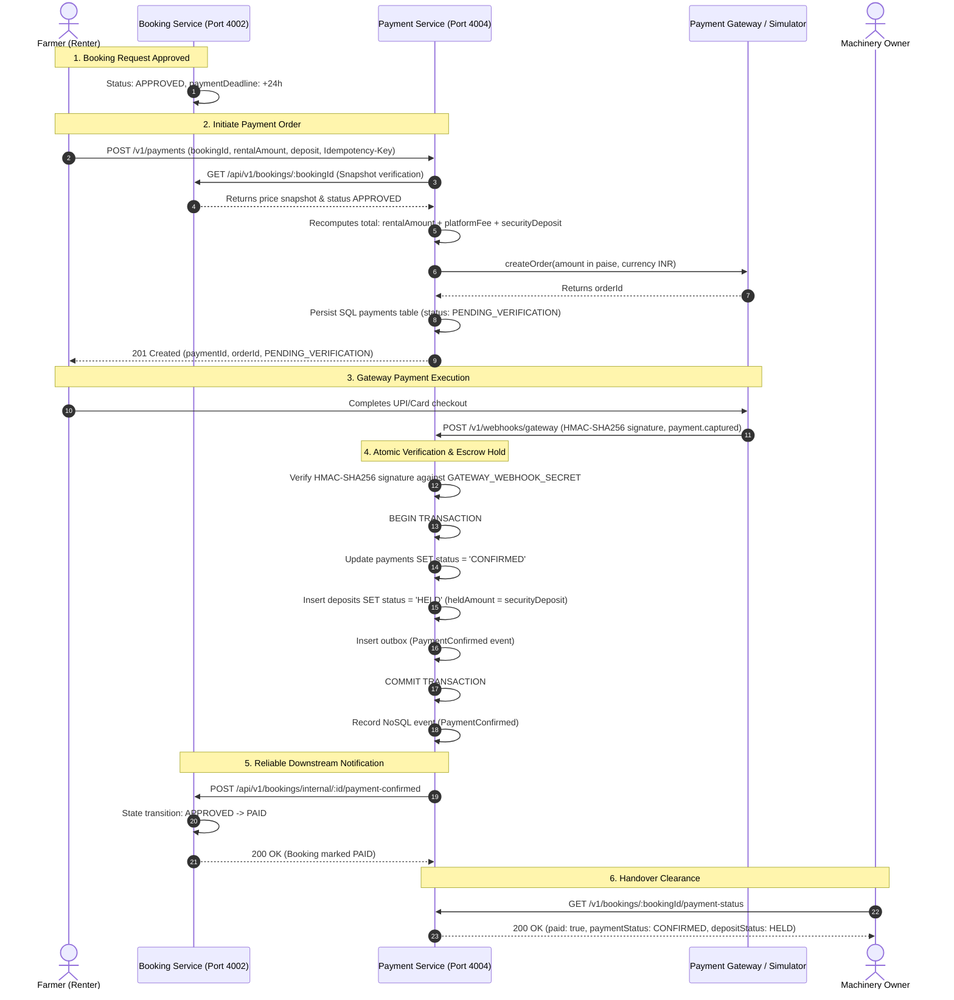

# AgriRent Microservice Contract: Payment & Security Deposit Service (Service 4)

## Architecture Overview & Sequence Diagram



---

## Operations Contract Sheets

### 1. InitiatePayment
- **Service Name**: Payment & Security Deposit Service
- **Operation**: `InitiatePayment`
- **Endpoint**: `POST /v1/payments`
- **Authentication**: Bearer JWT (`role: USER` or `ADMIN`), caller must be renter.
- **Idempotency**: `Idempotency-Key` header required. Persisted in SQL with SHA-256 request hash. Replaying same key + same body returns cached 201 with `Idempotent-Replayed: true`. Same key + different body returns 422 `IDEMPOTENCY_CONFLICT`. In-flight duplicate returns 409 `DUPLICATE_REQUEST`.
- **Preconditions**: Booking exists, status is `APPROVED`, `paymentDeadline` has not expired, user is verified.
- **Postconditions**: Payment record created in SQL `payments` table with status `PENDING_VERIFICATION`. Audit event written to NoSQL document store.
- **Dependencies**: Booking Service `GET /api/v1/bookings/:bookingId`, Payment Gateway `createOrder`.
- **Input Schema**:
  ```json
  {
    "bookingId": "BK-1A2B3C4D",
    "rentalAmount": 3000.00,
    "deposit": 500.00,
    "currency": "INR"
  }
  ```
- **Output Schema**:
  ```json
  {
    "paymentId": "PAY-5E6F7A8B",
    "bookingId": "BK-1A2B3C4D",
    "status": "PENDING_VERIFICATION",
    "gatewayStatus": "CREATED",
    "gatewayOrderId": "order_sim_12345",
    "totalAmount": 3800.00,
    "rentalAmount": 3000.00,
    "platformFee": 300.00,
    "securityDeposit": 500.00,
    "currency": "INR",
    "createdAt": "2026-10-25T00:00:00.000Z"
  }
  ```
- **Errors**: 400 `INVALID_AMOUNT`, 400 `INVALID_INPUT`, 400 `MISSING_IDEMPOTENCY_KEY`, 401 `UNAUTHENTICATED`, 403 `ACCESS_DENIED`, 404 `BOOKING_NOT_FOUND`, 409 `INVALID_BOOKING_STATE`, 409 `BOOKING_EXPIRED`, 422 `IDEMPOTENCY_CONFLICT`, 429 `RATE_LIMIT_EXCEEDED`, 503 `UPSTREAM_UNAVAILABLE`, 504 `UPSTREAM_TIMEOUT`.

---

### 2. VerifyPayment
- **Service Name**: Payment & Security Deposit Service
- **Operation**: `VerifyPayment`
- **Endpoint**: `POST /v1/payments/:paymentId/verifications` and `POST /v1/webhooks/gateway`
- **Authentication**: Bearer JWT for REST endpoint; HMAC-SHA256 signature header for webhook.
- **Idempotency**: Idempotent. Re-verifying a `CONFIRMED` payment returns HTTP 200 without creating duplicate deposits or notifications.
- **Preconditions**: Payment exists in `PENDING_VERIFICATION` status.
- **Postconditions**: In one atomic SQL transaction, payment becomes `CONFIRMED`, deposit becomes `HELD`, and outbox event `PaymentConfirmed` is written. Downstream Booking Service transitions to `PAID`.
- **Dependencies**: Gateway cryptographic signature check, Booking Service notification endpoint.
- **Input Schema**:
  ```json
  {
    "gatewayTransactionReference": "TXN-9F8E7D6C",
    "gatewayOrderId": "order_sim_12345",
    "signature": "hmac_signature_hex"
  }
  ```
- **Output Schema**:
  ```json
  {
    "status": "CONFIRMED",
    "paymentId": "PAY-5E6F7A8B",
    "bookingId": "BK-1A2B3C4D",
    "transactionReference": "TXN-9F8E7D6C",
    "depositId": "DEP-3B4C5D6E",
    "depositStatus": "HELD"
  }
  ```
- **Errors**: 401 `INVALID_SIGNATURE`, 404 `PAYMENT_NOT_FOUND`, 409 `INVALID_PAYMENT_STATE`, 422 `PAYMENT_FAILED`.

---

### 3. GetPaymentStatus (Handover Service Pre-Condition)
- **Service Name**: Payment & Security Deposit Service
- **Operation**: `GetPaymentStatus`
- **Endpoint**: `GET /v1/bookings/:bookingId/payment-status` (and SOAP `GetPaymentStatus` at `/soap/payments`)
- **Authentication**: Public or internal service lookup.
- **Idempotency**: Idempotent GET.
- **Preconditions**: Booking exists.
- **Postconditions**: None (read-only).
- **Dependencies**: SQL ledger `payments` and `deposits`.
- **Output Schema**:
  ```json
  {
    "bookingId": "BK-1A2B3C4D",
    "paymentId": "PAY-5E6F7A8B",
    "paymentStatus": "CONFIRMED",
    "depositStatus": "HELD",
    "paid": true,
    "totalAmount": 3800.00,
    "heldDeposit": 500.00,
    "currency": "INR",
    "transactionReference": "TXN-9F8E7D6C",
    "verifiedAt": "2026-10-25T00:00:00.000Z"
  }
  ```
- **Errors**: 404 `PAYMENT_NOT_FOUND`, 406 `NOT_ACCEPTABLE`.

---

### 4. HoldSecurityDeposit
- **Service Name**: Payment & Security Deposit Service
- **Operation**: `HoldSecurityDeposit`
- **Endpoint**: `POST /v1/bookings/:bookingId/deposit-holds`
- **Authentication**: Bearer JWT.
- **Idempotency**: Only one deposit may be HELD per booking (409 `DEPOSIT_ALREADY_HELD`).
- **Preconditions**: Booking has a `CONFIRMED` payment.
- **Postconditions**: Deposit record created/held in SQL `deposits` table.
- **Dependencies**: SQL `payments` table.
- **Errors**: 409 `DEPOSIT_ALREADY_HELD`, 422 `DEPOSIT_FAILED`.

---

### 5. RefundPayment
- **Service Name**: Payment & Security Deposit Service
- **Operation**: `RefundPayment`
- **Endpoint**: `POST /v1/payments/:paymentId/refunds`
- **Authentication**: Admin JWT or `INTERNAL_SERVICE_TOKEN`.
- **Idempotency**: `Idempotency-Key` header required. Duplicate key returns 409 `DUPLICATE_REFUND`.
- **Preconditions**: Payment is `CONFIRMED` or `PARTIALLY_REFUNDED`. Amount <= refundable remainder.
- **Postconditions**: SQL `refunds` row inserted. Payment `refundedAmount` incremented. Payment status transitions to `PARTIALLY_REFUNDED` or `REFUNDED`. Gateway refund invoked.
- **Dependencies**: Gateway refund API.
- **Input Schema**:
  ```json
  {
    "amount": 500.00,
    "reason": "Machinery early return adjustment"
  }
  ```
- **Output Schema**:
  ```json
  {
    "refundId": "REF-7A8B9C0D",
    "paymentId": "PAY-5E6F7A8B",
    "bookingId": "BK-1A2B3C4D",
    "amount": 500.00,
    "totalRefunded": 500.00,
    "paymentStatus": "PARTIALLY_REFUNDED",
    "status": "SUCCESS",
    "reason": "Machinery early return adjustment",
    "createdAt": "2026-10-25T00:00:00.000Z"
  }
  ```
- **Errors**: 400 `INVALID_INPUT`, 404 `PAYMENT_NOT_FOUND`, 409 `DUPLICATE_REFUND`, 422 `REFUND_NOT_ALLOWED`.

---

### 6. SettlePayment
- **Service Name**: Payment & Security Deposit Service
- **Operation**: `SettlePayment`
- **Endpoint**: `POST /v1/bookings/:bookingId/settlements`
- **Authentication**: Admin JWT or `INTERNAL_SERVICE_TOKEN`.
- **Idempotency**: Strictly allowed once per booking (409 `SETTLEMENT_ALREADY_COMPLETED`). `Idempotency-Key` header required.
- **Preconditions**: Booking has `CONFIRMED` payment and `HELD` deposit.
- **Formula**:
  - `depositBalance = heldDeposit - lateFine - damageDeduction`
  - `refundToRenter = depositBalance - disputedAmount`
  - `ownerPayout = rentalAmount + lateFine + damageDeduction`
  - Platform fee is retained by AgriRent platform and is NOT paid out to equipment owner.
  - `lateFine + damageDeduction` must not exceed `heldDeposit` (otherwise 422 `INVALID_DEDUCTION`).
- **Postconditions**: Settlement recorded in SQL `settlements` table. Deposit status updated to `RELEASED` or `PARTIALLY_DEDUCTED`. Audit event logged.
- **Dependencies**: SQL `payments` and `deposits` tables; Claims Client stub for adjuster deductions.
- **Input Schema**:
  ```json
  {
    "rentalAmount": 3000.00,
    "lateFine": 100.00,
    "damageDeduction": 200.00,
    "disputedAmount": 0.00
  }
  ```
- **Output Schema**:
  ```json
  {
    "settlementId": "SET-1A2B3C4D",
    "bookingId": "BK-1A2B3C4D",
    "rentalAmount": 3000.00,
    "platformFee": 300.00,
    "heldDeposit": 500.00,
    "lateFine": 100.00,
    "damageDeduction": 200.00,
    "depositBalance": 200.00,
    "refundToRenter": 200.00,
    "ownerPayout": 3300.00,
    "disputedAmount": 0.00,
    "status": "COMPLETED",
    "depositStatus": "PARTIALLY_DEDUCTED",
    "settledAt": "2026-10-25T00:00:00.000Z"
  }
  ```
- **Errors**: 400 `INVALID_INPUT`, 409 `SETTLEMENT_ALREADY_COMPLETED`, 422 `INVALID_DEDUCTION`, 422 `INVALID_BOOKING_STATE`.
