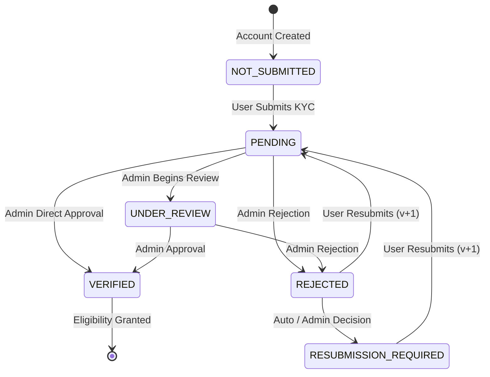

# AgriRent — KYC State Machine & Verification Workflow

This document details the KYC verification lifecycle and state transition rules for AgriRent's Identity and KYC Service.

---

## 1. State Machine Diagram

---

## 2. Supported KYC Statuses

| Status | Description | Allowed Next States |
|---|---|---|
| `NOT_SUBMITTED` | Initial state upon user registration. No documents filed. | `PENDING` |
| `PENDING` | User has submitted documents. Awaiting review. | `UNDER_REVIEW`, `VERIFIED`, `REJECTED` |
| `UNDER_REVIEW` | Administrator has opened and is actively inspecting the dossier. | `VERIFIED`, `REJECTED` |
| `VERIFIED` | Administrator has verified authenticity. High-value actions unlocked. | *(Terminal active state)* |
| `REJECTED` | Dossier rejected due to invalid, illegible, or expired credentials. | `RESUBMISSION_REQUIRED`, `PENDING` (via resubmit) |
| `RESUBMISSION_REQUIRED`| Feedback sent to user requesting clearer documents. | `PENDING` (via resubmit) |

---

## 3. Transition Rules & Preconditions

### 3.1 Submission (`NOT_SUBMITTED` / `REJECTED` $\to$ `PENDING`)
- **Actor:** Authenticated User (`USER` role).
- **Preconditions:**
  - User must be in `ACTIVE` account status.
  - No active submission in `PENDING` or `UNDER_REVIEW` state.
  - Document type must be in approved categories (`GOVERNMENT_ID`, `AADHAAR`, `PAN`, `DRIVING_LICENSE`, `PASSPORT`, `VOTER_ID`, `FARMER_ID`).
  - Document reference must be provided as a secure URI/token (never raw binary in DB).
- **Postconditions:**
  - A new `KYCSubmission` record is generated with unique `kycId`.
  - For resubmissions, `version` is incremented.
  - `User.kycStatus` is updated to `PENDING`.
  - Security audit event `KYC_SUBMITTED` recorded.

### 3.2 Approval (`PENDING` / `UNDER_REVIEW` $\to$ `VERIFIED`)
- **Actor:** Authenticated Administrator (`ADMIN` role).
- **Preconditions:**
  - Submission must be in `PENDING` or `UNDER_REVIEW`.
  - **Self-Verification Guard:** Administrator cannot approve their own submission (`submission.userId !== adminUserId`).
- **Postconditions:**
  - Submission status updated to `VERIFIED`.
  - `reviewedAt = new Date()`, `reviewedBy = adminUserId`.
  - `User.kycStatus` updated to `VERIFIED`.
  - Equipment listing and machine booking permissions immediately become eligible.
  - Security audit event `KYC_APPROVED` recorded.

### 3.3 Rejection (`PENDING` / `UNDER_REVIEW` $\to$ `REJECTED`)
- **Actor:** Authenticated Administrator (`ADMIN` role).
- **Preconditions:**
  - Submission must be in `PENDING` or `UNDER_REVIEW`.
  - Administrator must supply a non-empty `reason`.
- **Postconditions:**
  - Submission status updated to `REJECTED`.
  - `rejectionReason` stored.
  - `reviewedAt = new Date()`, `reviewedBy = adminUserId`.
  - `User.kycStatus` updated to `REJECTED`.
  - User can resubmit with corrected documents.
  - Security audit event `KYC_REJECTED` recorded.
